# FreshSave 🌿

**Rescue good food. Save good money.**

FreshSave is an Android app for a surplus-food rescue marketplace in Dhaka, Bangladesh. Cafés, bakeries and shops post the food they didn't sell at a big discount; shoppers nearby reserve it, pay with bKash, Nagad or card, and pick it up with a 4-character code before closing time. Less food in the bin, more money in everyone's pocket.

The app has two sides — **Shopper** and **Business** — and implements all 23 screens from the UI design in [`docs/App.pdf`](docs/App.pdf). It runs fully offline on realistic mock data (Tasty Treat, Star Kabab, Agora Fresh in Banani, Gulshan and Dhanmondi), and the data layer is built so a real backend can be plugged in later.

---

## Screenshots

**Getting started**

| Splash | Onboarding | Log in | Choose a role |
|:---:|:---:|:---:|:---:|
| 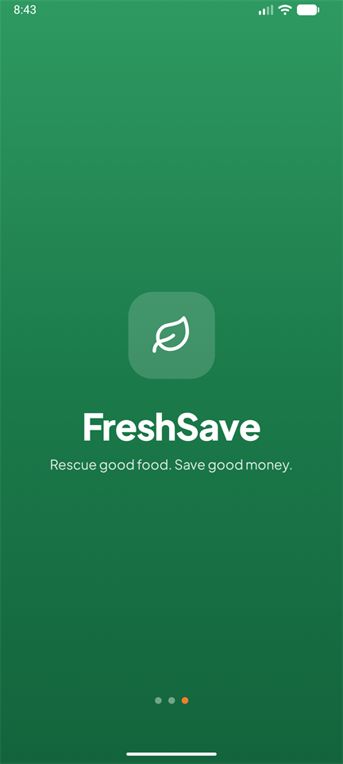 | 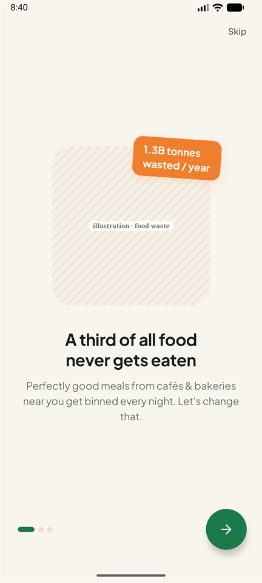 | 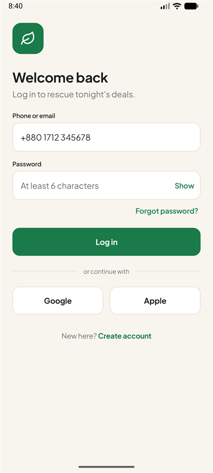 | 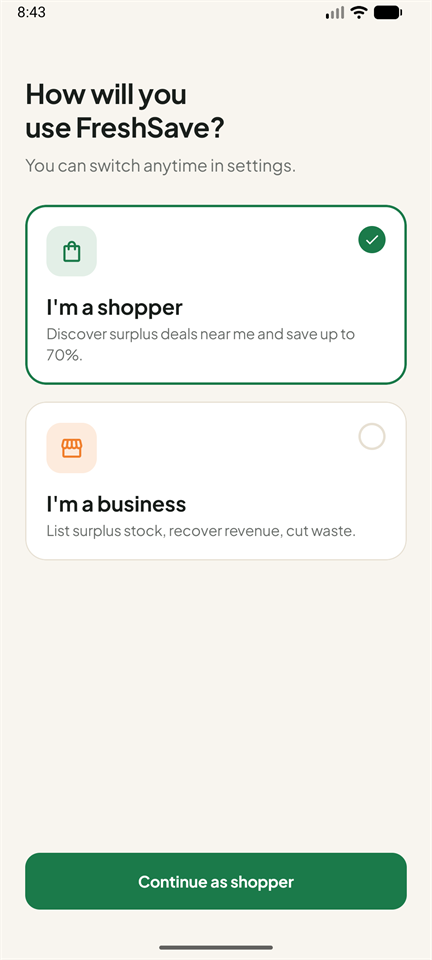 |

**Shopper**

| Home feed | Deal detail | Search & filters | Checkout |
|:---:|:---:|:---:|:---:|
| 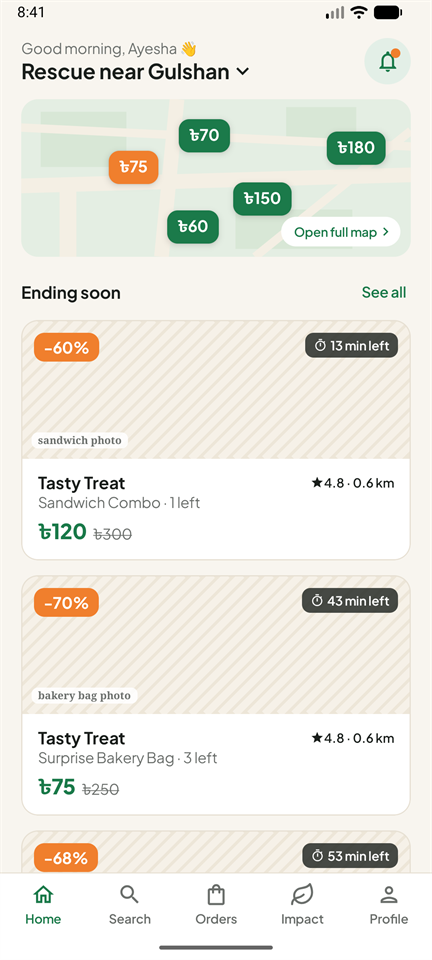 | 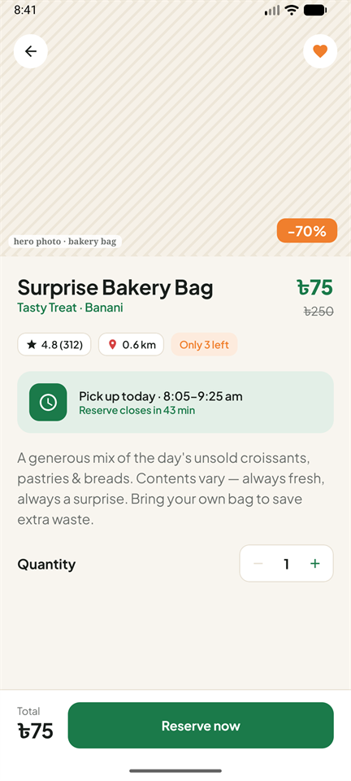 | 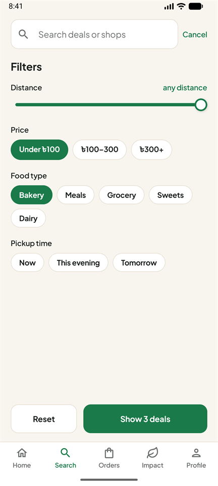 | 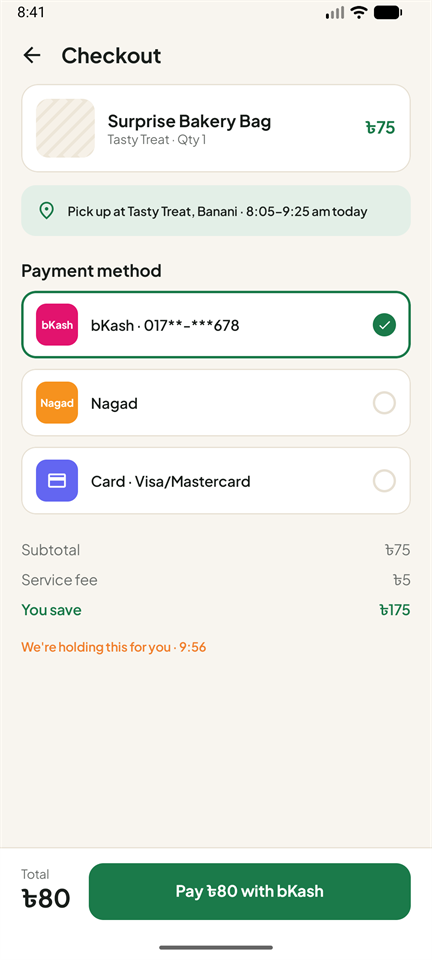 |

| Order confirmation | My orders | Impact | Profile |
|:---:|:---:|:---:|:---:|
| 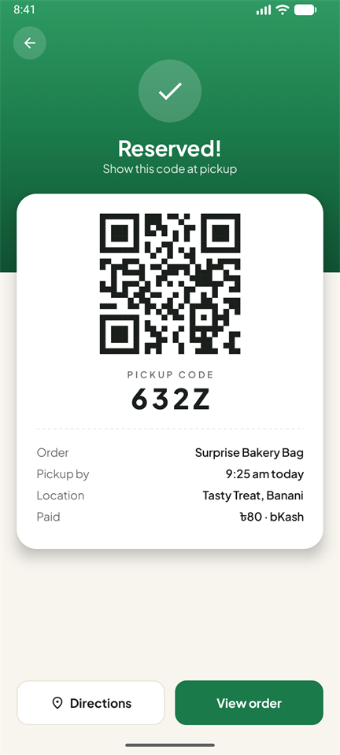 | 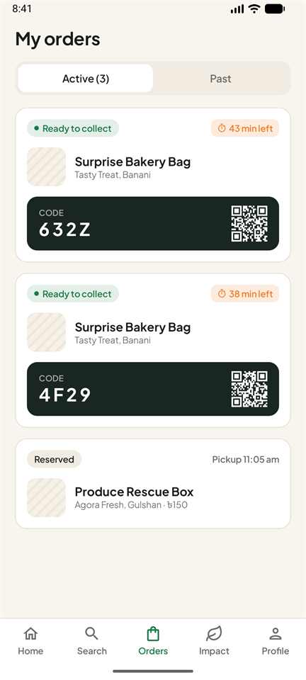 | 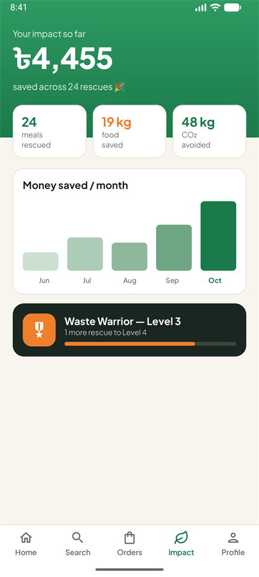 | 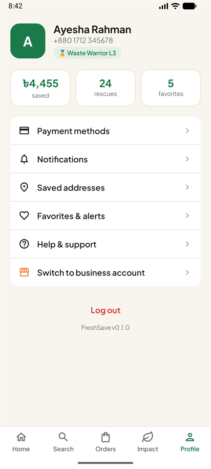 |

**Business**

| Dashboard | Create listing | Pickup queue | Analytics |
|:---:|:---:|:---:|:---:|
| 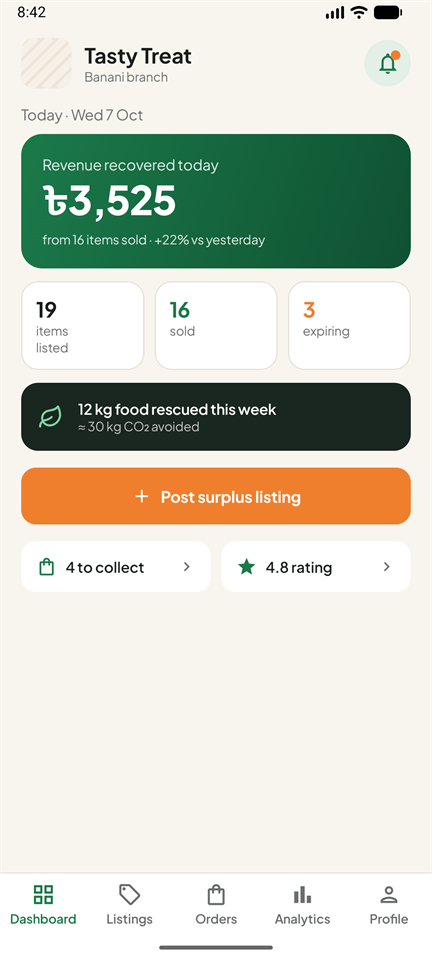 | 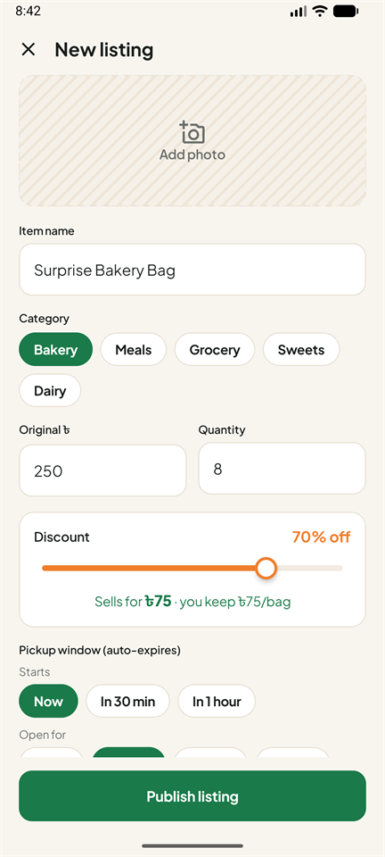 | 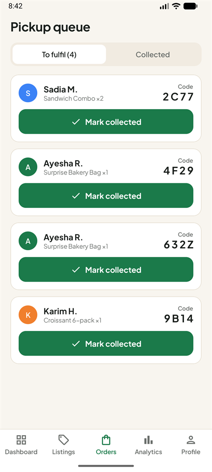 | 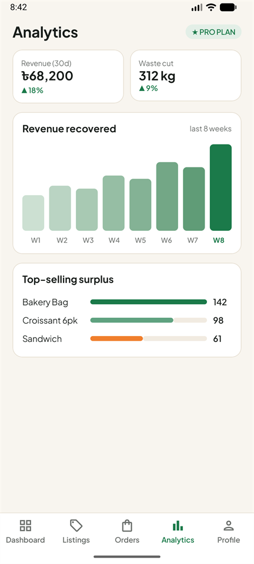 |

**Dark mode**

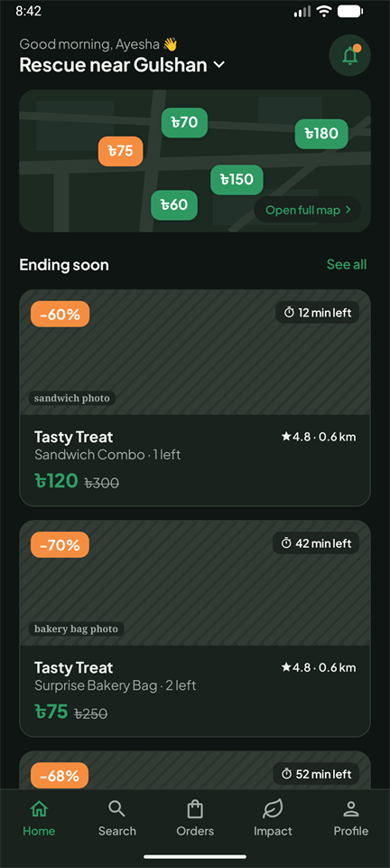

---

## Features

### Shopper
- **Home feed** with an area picker, a mini-map of nearby deals (price pins) and an "Ending soon" list with live countdowns
- **Deal detail**: discount, rating, distance, stock left, pickup window, quantity stepper, save shop to favorites
- **Search & filters** that really filter: text, distance slider, price range, food type, pickup time
- **Checkout** with bKash / Nagad / card (mocked) and a 10-minute hold timer
- **Order confirmation** with a real, scannable **QR code** and a 4-character pickup code; directions open your maps app
- **My orders**: Active / Past tabs, live "x min left", pickup code card, rate a collected pickup
- **Favorites & alerts**, **Impact dashboard** (money saved, meals, CO₂, monthly chart, levels), **Rate & review**, **Profile & settings**

### Business
- **Dashboard**: revenue recovered today, items listed / sold / expiring, weekly impact
- **Create / edit listing**: photo picker, category, discount slider that recalculates the price, auto-expiring pickup window
- **Manage listings**: Edit, Expire now, Extend window, Relist
- **Pickup queue**: Mark collected after verifying the customer's code
- **Analytics (Pro)**: 30-day KPIs, 8-week revenue chart, top sellers
- **Business profile** with branches, and **Ratings received** with replies

### Shared
- **Notifications inbox** (tap to jump to the deal, order or review), **Help & support** with searchable FAQ
- Login and role are **remembered across restarts**
- Light and **dark theme**, screen transitions, loading and empty states

Everything is connected: reserving a deal lowers "X left", the order appears in *My orders* **and** in the business *Pickup queue*, "Mark collected" moves it to *Past*, and a new listing shows up on the shopper Home feed.

---

## Tech stack

| | |
|---|---|
| Language | Kotlin |
| UI | Jetpack Compose, Material 3, Plus Jakarta Sans (bundled variable font) |
| Navigation | Navigation Compose with type-safe `@Serializable` routes, single Activity |
| Architecture | MVVM — one ViewModel per screen exposing `StateFlow` UI state |
| Async | Kotlin Coroutines & Flow |
| Persistence | Jetpack DataStore (session: logged in + role) |
| Images | Coil 3 (photo picker images; ready for real photo URLs) |
| QR codes | ZXing core |
| DI | Manual, via a single `AppContainer` |
| Build | Gradle (Kotlin DSL) with a version catalog, AGP 9, minSdk 26, targetSdk 37 |
| Tests | JUnit 4 + kotlinx-coroutines-test |

---

## Architecture

```
UI (Compose screens)  ──observes──▶  ViewModel (StateFlow<UiState>)  ──calls──▶  Repository interface
                                                                                     │
                                                                  today: Fake* (in-memory mock data)
                                                                  later: Firebase / REST implementation
```

- **Screens** are split into a stateless `XxxScreen(state, callbacks)` (with `@Preview`s) and a small `XxxRoute` that gets its ViewModel and collects state.
- **ViewModels** combine repository flows into one immutable `UiState` and expose it as a `StateFlow`. One-off results (e.g. "order placed") are fields in the state that the screen reacts to.
- **Repositories** are interfaces in `data/repository`. The fakes in `data/fake` keep data in `MutableStateFlow`s, so every screen updates automatically when anything changes — e.g. a reservation made on the shopper side instantly shows in the business queue.
- **`AppContainer`** builds every repository once. Swapping a fake for a real backend means changing one line there.
- **`AppClock`** is one shared ticking clock, so all countdowns stay in sync and listings expire on time.

```
app/src/main/java/com/freshsave/app/
├── data/
│   ├── model/        plain data classes (Deal, Order, Review…)
│   ├── repository/   interfaces the UI depends on
│   ├── fake/         in-memory implementations + MockData
│   ├── local/        DataStore session
│   └── AppClock.kt
├── di/AppContainer.kt
├── navigation/       routes, NavHost, bottom-bar logic
├── feature/          one package per screen (Screen + ViewModel)
│   └── business/     dashboard, listing, listings, queue, analytics, profile, ratings
├── ui/components/    DealCard, DiscountBadge, TimerBadge, FilterChip, PrimaryButton, StatTile,
│                     SettingsRow, ToggleRow, PickupCodeCard, QrCode, BarChart, bottom bars…
├── ui/theme/         colours, typography, light/dark themes
└── util/             ৳ formatting, times and countdowns
```

---

## How to run

**Requirements:** Android Studio (recent version) with an Android SDK, and an emulator or a phone running Android 8.0+.

1. Clone the repo and open the folder in Android Studio. It creates `local.properties` with your SDK path.
2. Press **Run ▶**, or from a terminal with an emulator running:
   ```bash
   ./gradlew installDebug        # build and install
   ./gradlew test                # run the unit tests
   ./gradlew assembleDebug       # APK at app/build/outputs/apk/debug/app-debug.apk
   ```
3. On the login screen, any phone number or email with a password of **6+ characters** works. Google and Apple buttons sign you in directly.

> All data is mock data held in memory, so orders and listings reset when the app process restarts. Your login and chosen role are saved.

### Demo pickup codes

In the business **Pickup queue**, *Mark collected* asks for the customer's code:

| Customer | Item | Code |
|---|---|---|
| Sadia M. | Sandwich Combo ×2 | `2C77` |
| Ayesha R. | Surprise Bakery Bag ×1 | `4F29` |
| Karim H. | Croissant 6-pack ×1 | `9B14` |

Orders you place as a shopper get a new random code, shown on the confirmation screen and in *My orders*. A wrong code is rejected.

### Switching to the business role

- At first launch choose **"I'm a business"** on the role screen, **or**
- as a shopper go to **Profile → Switch to business account**.

The business account manages **Tasty Treat (Banani)**. To go back, use **Profile → Switch to shopper account**. A nice demo: reserve the *Surprise Bakery Bag* as a shopper, switch to business, and find the order in the Pickup queue.

---

## Where the app differs from App.pdf (and why)

| In the design | In the app | Why |
|---|---|---|
| Submit review → "business profile" | Returns to the previous screen with a thank-you message | Shoppers have no business-profile screen in the design |
| No arrow leads to *Ratings received* | Opens from the business profile (★ rating / Ratings row), the dashboard shortcut and review notifications | So the screen is reachable |
| "Create account" → a separate sign-up screen | Switches the login form into sign-up mode | No sign-up screen was designed |
| Full map / area picker | Drawn map placeholder with tappable price pins; area picker as a bottom sheet | Google Maps needs an API key (left as a TODO) |
| Mark collected | Asks staff to type the customer's code first | The design says it "verifies the code"; this makes that real |
| Help: "Show the 4-digit code" | "4-character code" | Codes contain letters (e.g. `4F29`) |
| Fixed times like "6:30–8:00 pm", "Wed 23 Jul" | Times and dates relative to *now* | So countdowns always look right whenever you open the app |
| Some numbered arrows in the PDF point at the wrong element (screens 17, 20) | Followed the labels | The labels describe the intent |

Extras not in the design: Edit/Relist flows, review replies, branch toggles, dark mode, loading/empty states.

---

## TODO

- [ ] Real backend (Firebase or REST) behind the repository interfaces; persist orders and listings
- [ ] Google Maps Compose in `MapPlaceholder` (home mini-map and full map)
- [ ] Real authentication: phone OTP, Google and Apple sign-in
- [ ] Real payments: bKash, Nagad and card SDKs
- [ ] Push notifications for deal alerts; live support chat
- [ ] Payment methods, saved addresses, business hours, payout and staff screens (currently "coming soon")
- [ ] Real food photos (Coil is already wired up)
- [ ] UI tests (Compose) and more unit tests

---

## How it was built

The UI/UX design — all 23 annotated screens in [`docs/App.pdf`](docs/App.pdf) — is my own work.

**The code in this repository was written with [Claude Code](https://claude.com/claude-code), Anthropic's AI coding assistant.** I gave it the design PDF and a written brief ([`FRESHSAVE_PROMPT.md`](FRESHSAVE_PROMPT.md)) describing the tech stack and behaviour I wanted. It then built the app in six phases (theme and components → onboarding → shopper flow → shopper extras → business side → polish). After each phase it compiled the app, installed it on an Android emulator, took screenshots, compared them with the PDF and fixed differences. It also wrote the unit tests and this README.

I'm using this project to learn Kotlin and Jetpack Compose, which is why the code has plenty of short explanatory comments.
